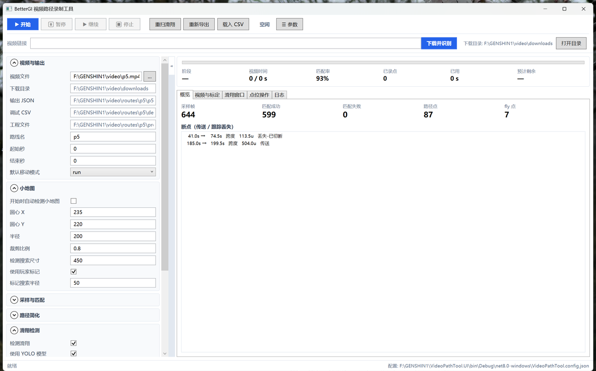
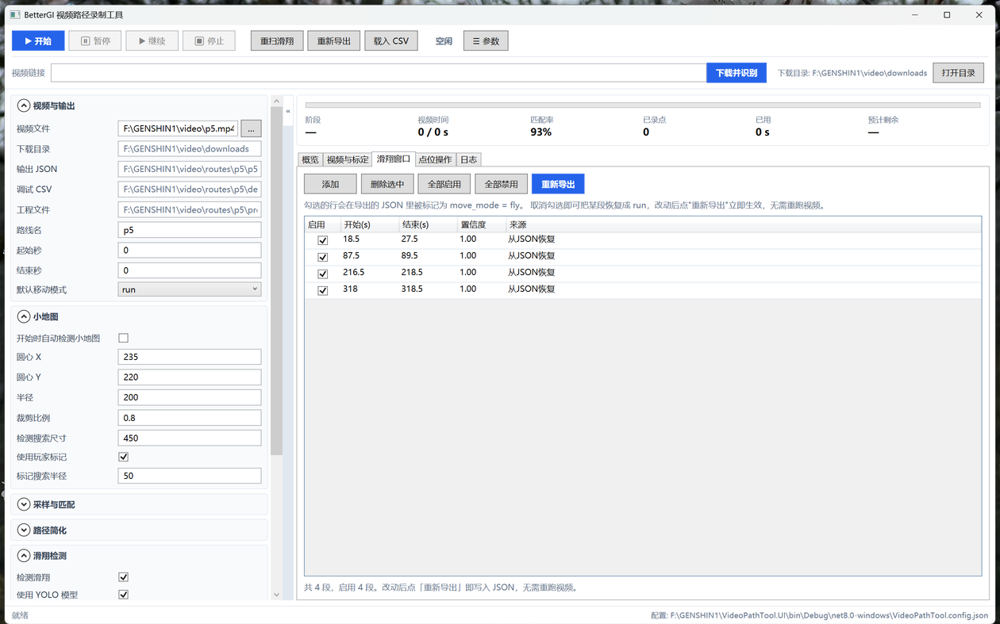

# VideoPathTool

Turn a screen recording of a Genshin Impact route into a [BetterGI] **pathing JSON** file.

[](https://github.com/Cnewbeee/VideoPathTool/actions/workflows/build.yml)
[](LICENSE)
[](https://dotnet.microsoft.com/)

A route video only contains pixels — the game coordinates have to be recovered.
This tool matches the minimap in every frame against the in-game map, simplifies
the resulting trace into waypoints, finds the gliding legs, and lets you annotate
individual moments before exporting a JSON that BetterGI can execute.

[中文说明](README.zh-CN.md)



## Features

- **Video → coordinates.** Minimap template matching plus SIFT re-sync when the
  player crosses a region the template match loses. Handles teleports: a jump
  that cannot have been walked becomes a `teleport` waypoint instead of a
  straight line through a mountain.
- **Path simplification with a guarantee.** Ramer–Douglas–Peucker with a hard
  cap on how far the simplified line may stray from the recorded one, plus a
  corner guard so short sharp turns survive.
- **Glide detection.** A small YOLOv8n ONNX model detects the deployed wind
  glider in the minimap; a geometric heuristic is used when the model is absent.
  Detected windows become `move_mode: "fly"` waypoints.
- **Point actions.** Bind a BetterGI action, an `orientation` waypoint, a
  per-point move mode or a small coordinate offset to any moment of the video.
- **Minimap by drag.** Drag a box around the minimap in the preview and the
  centre and radius are filled in — no guessing three numbers, which matters
  when a new video has a different resolution or HUD scale.
- **Annotation timeline.** The whole video's markings as one strip — click to
  seek, see at a glance what is still unmarked.
- **Resume editing.** One folder per video keeps the export, the recorded
  samples and the editor state together, so re-exporting never needs the video
  again.
- **A preview proxy for slow codecs.** AV1 footage decodes at ~85 ms per frame
  in software, which makes scrubbing take seconds; one ffmpeg pass produces an
  H.264 copy that seeks 15x faster. Recording still reads the original.
- **Link → route.** Paste a Bilibili/YouTube link and the tool downloads it
  (yt-dlp), detects the minimap circle, records and exports in one go.



## Requirements

| | |
|---|---|
| OS | Windows 10 / 11 (WPF UI, OpenCV native bindings) |
| Runtime | [.NET 8 SDK](https://dotnet.microsoft.com/download) to build, .NET 8 Desktop Runtime to run |
| Map assets | **not included** — see below |
| yt-dlp | optional, only for downloading a route from a link |

### Map assets are not bundled

Matching needs the game's own map images (`...\Assets\Map\Teyvat`). They are
copyrighted game content, so they are not redistributed here. Point
`map_assets_dir` in the config at a copy you already have — for example the one
shipped with BetterGI or a grasscutter-style asset dump.

Without it the recorder cannot match anything, so this is the first thing to set.

## Download

Grab `VideoPathTool-win-x64.zip` from the [latest release][releases] and unpack
it wherever you like. It needs the [.NET 8 Desktop Runtime][runtime]; everything
else — including the glide model and the OpenCV native libraries — is inside the
archive.

On first launch it writes `VideoPathTool.config.json` next to the executable.
Point `map_assets_dir` at your map assets before recording (see below).

[releases]: https://github.com/Cnewbeee/VideoPathTool/releases/latest
[runtime]: https://dotnet.microsoft.com/download/dotnet/8.0

## Build from source

```powershell
git clone https://github.com/Cnewbeee/VideoPathTool.git
cd VideoPathTool

# console tool
dotnet build VideoPathTool\VideoPathTool.csproj -c Release

# WPF editor
dotnet build VideoPathTool.UI\VideoPathTool.UI.csproj -c Release
```

Run the editor:

```powershell
VideoPathTool.UI\bin\Release\net8.0-windows\VideoPathTool.UI.exe
```

The first launch writes `VideoPathTool.config.json` next to the executable.
All data defaults to folders beside the program (`video\downloads`,
`video\routes\`, `tools\`), so nothing outside the program folder is touched.

## Quick start

1. Put `yt-dlp.exe` into `tools\` (or set `yt_dlp_path`, or have it on `PATH`).
2. Set `map_assets_dir` to your map asset folder.
3. Launch the UI, paste a route video link, press **下载并识别** — it downloads,
   detects the minimap circle, records and exports.
4. Open the **视频与标定** tab: play the video, mark missing glide segments with
   **F8**, add actions with **F9**.
5. Press **重新导出** — this rewrites the JSON in milliseconds without touching
   the video again.

## Output

A standard BetterGI pathing task. Coordinates are game units; `fly` makes
BetterGI deploy the glider; `action` runs a BetterGI action on arrival.

```json
{
  "info": { "name": "p5", "type": "collect", "map_name": "Teyvat" },
  "positions": [
    { "id": 1, "x": 9191.09, "y": 2852.12, "type": "teleport", "move_mode": "run" },
    { "id": 2, "x": 9205.61, "y": 2857.72, "action": "use_gadget",
      "action_params": "5", "move_mode": "run", "type": "path" }
  ]
}
```

Unknown fields are ignored by BetterGI's deserialiser, so the extra bookkeeping
this tool writes does no harm.

## Directory layout

```
video\downloads\<title>.mp4          source video
video\routes\<name>\<name>.json      the deliverable — one per video
video\routes\<name>\debug.csv        recorded samples (rebuild without the video)
video\routes\<name>\project.json     editor state: glide windows + point actions
video\routes\<name>\previews\        match previews for debugging
video\routes\_archive\               superseded artefacts
```

## Keyboard shortcuts (video tab)

| Key | Action |
|---|---|
| `Space` | play / pause |
| `←` / `→` | step one frame |
| `Shift` + `←` / `→` | step one second |
| `F8` | mark glide start / end |
| `F9` | add a point action at the current frame |
| `Ctrl` + `B` | collapse / expand the parameter panel |

Function keys are used for the two marking actions on purpose: a Chinese IME
swallows plain letter keys before they reach the window.

## Documentation

| Document | Content |
|---|---|
| [VideoPathTool.UI/README.md](VideoPathTool.UI/README.md) | UI, scheduler, timeline, annotations (Chinese) |
| [VideoPathTool/PATHSIMPLIFY.md](VideoPathTool/PATHSIMPLIFY.md) | how waypoints are simplified |
| [VideoPathTool/GLIDER_YOLO.md](VideoPathTool/GLIDER_YOLO.md) | glide detection model: data, training, results |
| [VideoPathTool/GLIDER_ANALYSIS.md](VideoPathTool/GLIDER_ANALYSIS.md) | why a learned detector beats the heuristic |
| [VideoPathTool/GLIDER_ROUTEA.md](VideoPathTool/GLIDER_ROUTEA.md) | the heuristic detector |

## Limitations

- **BetterGI has no "press this key" action.** Its action list is a fixed enum;
  anything else throws. The tool offers that real list instead of accepting a
  free-form string. Keyboard actions are reached indirectly (`use_gadget` = Z,
  `stop_flying` = jump + attack, ...).
- Glide windows recovered from an exported JSON are inferred from which
  waypoints were `fly`, so a short glide with no waypoint inside it cannot be
  reconstructed. Mark it with `F8` instead.
- Windows only, and the UI needs a working WPF/Desktop runtime.

## Not included in this repository

| What | Why |
|---|---|
| Map images from the game | copyrighted game content |
| Route videos and extracted frames | the footage belongs to whoever recorded it |
| YOLO training dataset | gigabytes of frames derived from those videos |
| `yt-dlp.exe` | download it from the yt-dlp project |
| A clone of BetterGI | separate project; only its JSON schema is targeted |

The bundled `VideoPathTool\glider.onnx` is trained weight-only, on frames from a
route video supplied by the author. No video, frame or annotation is
redistributed. Re-training your own model is documented in
[GLIDER_YOLO.md](VideoPathTool/GLIDER_YOLO.md).

## Credits

- [BetterGI](https://github.com/babalae/better-genshin-impact) — the pathing
  format this tool targets, and the recorder/executor that consumes it.
- [yt-dlp](https://github.com/yt-dlp/yt-dlp) — video download.
- [OpenCvSharp](https://github.com/shimat/opencvsharp),
  [ONNX Runtime](https://github.com/microsoft/onnxruntime),
  [Ultralytics](https://github.com/ultralytics/ultralytics) — vision and model.

## License

[MIT](LICENSE). The bundled model weights are covered by the same license;
game assets and third-party tools are not.
